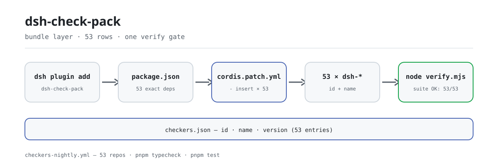

<div align="center">

<picture>
  <source media="(prefers-color-scheme: dark)" srcset="docs/assets/dsh-check-pack-flow-dark.svg">
  
</picture>

# dsh-check-pack

**Install all 53 PerryLink compliance checkers with one command — a single bundle layer inserts all 53 Cordis rows.**

The suite entry point for China-domain document checks (trade, customs, bids, HSE, medical, legal, government, manufacturing): every checker keeps its own npm name, rule pack, and version; this package only brings them in together.

[Install](#three-step-setup) · [Configuration](#configuration) · [FAQ](#faq) · [简体中文](README.md) · [English](README.en.md) · [Español](README.es.md) · [Português](README.pt.md) · [हिन्दी](README.hi.md)

[](LICENSE)
[](#compatibility)
[](https://www.npmjs.com/package/dsh-check-pack)
[](https://github.com/PerryLink/dsh-check-pack/actions/workflows/ci.yml)
[](#compatibility)

[](https://github.com/PerryLink/dsh-check-pack/stargazers)
[](https://www.npmjs.com/package/dsh-check-pack)
[](https://dshfind.com/plugins/PerryLink/dsh-check-pack?ref=badge)
[](https://gitee.com/perrylink/dsh-check-pack)

```sh
dsh plugin --profile <name> add dsh-check-pack
```

</div>

<sub>Community plugin, not affiliated with DeepSeek. Canonical repository: <https://github.com/PerryLink/dsh-check-pack> (Gitee is a mirror).</sub>

## What it is

`dsh-check-pack` is the suite entry point that installs **all 53 PerryLink compliance checkers** with one command. It contains no checking logic of its own: the bundled `cordis.patch.yml` is one bundle layer that `insert`s 53 Cordis rows at install time, wiring each checker into the active profile at the version pinned in `checkers.json`.

The dependency list is the member list — 53 `dsh-*` packages at exact versions. Each checker keeps its own npm name, rule pack, README, and version; upgrades and configuration happen on its side. This package was formerly the deprecated [`@perrylink/dsh-checkers`](https://www.npmjs.com/package/@perrylink/dsh-checkers); it is now named `dsh-check-pack`, so install it under the new name.

Coverage is China-domain documents: trade, customs, bids, HSE, medical, legal, government, manufacturing. Every checker only reports differences inside the material — **it never makes a legal, medical, or customs determination**. The conclusion stays with the reviewer.

## Three-step setup

1. **Install** (pick one channel):

   ```sh
   # npm channel (published releases)
   dsh plugin --profile web add dsh-check-pack
   # git channel (latest main; equivalent to git+https://github.com/PerryLink/dsh-check-pack.git)
   dsh plugin --profile web add github:PerryLink/dsh-check-pack
   # tarball channel: npm pack in this repo, then
   dsh plugin --profile web add ./dsh-check-pack-<version>.tgz
   ```

   > Per this repository's record: npm stages new versions for 2FA approval; if `npm view dsh-check-pack version` does not show the latest release, use the git channel first.

2. **Minimal configuration**: none. The bundle patch inserts all 53 rows with each checker's defaults; to tune one checker, change its keys in its own README — this package has nothing to configure.

3. **Verify it took effect**:

   ```sh
   dsh --profile web --dump-config | grep -A1 'id: dsh-aqua-input-check'
   ```

   Seeing any checker row from the suite means the bundle layer has expanded. You can also run the consistency gate in this repository:

   ```sh
   node verify.mjs
   # => suite OK: 53 rows, 53 dependencies
   ```

**Uninstall**: `dsh plugin --profile web remove dsh-check-pack` removes the suite row; checkers you installed individually still need their own `remove`.

## Core capabilities

- **One command, 53 checkers** — no per-checker `add`: one `insert` in `cordis.patch.yml` brings all 53 rows in, so installing one package installs the whole suite.
- **Exact version pins** — all 53 dependencies in `package.json` are exact versions; `checkers.json` records the same `id` / `name` / `version` triples; `verify.mjs` keeps the three in agreement.
- **Entry point only, no adjudication** — this package has no checking code and never reads or writes business documents; rules, severities, and report wording belong to each checker and are unchanged here.
- **No capabilities, no registrations** — `dsh.capabilities` is an empty array: no tools, commands, services, events, or HTTP routes, only the inserted bundle rows.
- **Regenerable manifests** — `node build.mjs` can rebuild the dependencies, `cordis.patch.yml`, and `checkers.json` from `../../checkers` in the workspace; that directory is absent in the standalone repo, so regeneration is optional.
- **Nightly upstream health check** — `checkers-nightly.yml` clones all 53 checker repositories every day at 18:00 UTC and runs `pnpm run typecheck` plus `pnpm test`; `ci.yml` runs `node verify.mjs` and `npm pack --dry-run` on Node 22.

## Configuration

This package registers no configuration keys and has no Schemastery `Config`: all it does is insert 53 rows whose `id` / `name` are the checker package names, with `config` left empty so each checker uses its defaults. To tune parameters, go to the relevant checker's README (for example `rulesFile`, `disabledRules`, `onlyRules`, and `timeoutMs` in [`dsh-aqua-input-check`](https://github.com/PerryLink/dsh-aqua-input-check)) — those keys belong to the checkers, not to this package.

This package's own manifest fields:

| Field | Value | Meaning |
|---|---|---|
| `dsh.manifestVersion` | `1` | bundle manifest version |
| `dsh.bundle.patch` | `./cordis.patch.yml` | bundle patch applied at install time |
| `dsh.capabilities` | `[]` | requests no host capabilities |
| `engines.dsh` | `>=0.2.1-0 <0.3.0` | runtime range |
| `engines.node` | `^22.19.0 \|\| >=24.0.0` | Node range |
| `dependencies` | 53 exact versions | suite members and pinned versions |

<details>
<summary>Full suite manifest (53 members, quoted verbatim from checkers.json)</summary>

| Package | Version |
|---|---|
| `dsh-aqua-input-check` | `0.2.11` |
| `dsh-archive-check` | `0.2.9` |
| `dsh-bid-ca-precheck` | `0.2.11` |
| `dsh-bid-qual-check` | `0.2.10` |
| `dsh-contract-stance` | `0.2.9` |
| `dsh-customs-doc-check` | `0.2.8` |
| `dsh-demurrage-ledger` | `0.2.9` |
| `dsh-drill-script-check` | `0.2.8` |
| `dsh-eia-guide-check` | `0.2.9` |
| `dsh-emergency-plan` | `0.2.8` |
| `dsh-essay-rubric-check` | `0.2.8` |
| `dsh-evidence-check` | `0.2.11` |
| `dsh-export-ctl-check` | `0.2.11` |
| `dsh-fmea-table-check` | `0.2.8` |
| `dsh-forecast-penalty` | `0.2.8` |
| `dsh-gongwen-flow-check` | `0.2.9` |
| `dsh-gongwen-word-check` | `0.2.10` |
| `dsh-guard-plan-qc` | `0.2.8` |
| `dsh-hazchem-check` | `0.2.11` |
| `dsh-hazplan-check` | `0.2.10` |
| `dsh-hidden-risk-map` | `0.2.8` |
| `dsh-hs-classify` | `0.2.10` |
| `dsh-icd-rule-check` | `0.2.10` |
| `dsh-lawcite-adapter` | `0.2.10` |
| `dsh-lc-doc-check` | `0.2.9` |
| `dsh-learning-gap-check` | `0.2.8` |
| `dsh-medrec-qc` | `0.2.11` |
| `dsh-nsfc-form-check` | `0.2.10` |
| `dsh-nurse-record-check` | `0.2.10` |
| `dsh-origin-rvc-check` | `0.2.9` |
| `dsh-ota-review-check` | `0.2.10` |
| `dsh-paper-doc-adapter` | `0.2.8` |
| `dsh-permit-report-check` | `0.2.10` |
| `dsh-pipeline-check` | `0.2.8` |
| `dsh-pleading-draft` | `0.2.10` |
| `dsh-policy-brief-draft` | `0.2.10` |
| `dsh-power-loss-split` | `0.2.9` |
| `dsh-power-ticket-check` | `0.2.9` |
| `dsh-ppap-check` | `0.2.8` |
| `dsh-protest-deadline` | `0.2.10` |
| `dsh-railway-window` | `0.2.8` |
| `dsh-repair-order-qc` | `0.2.10` |
| `dsh-review-reply-check` | `0.2.8` |
| `dsh-rulefile-check` | `0.2.8` |
| `dsh-safety-brief-check` | `0.2.9` |
| `dsh-site-log-check` | `0.2.11` |
| `dsh-soe-decision-check` | `0.2.13` |
| `dsh-soilwater-check` | `0.2.8` |
| `dsh-sop-sync-check` | `0.2.8` |
| `dsh-spc-gbt-adapter` | `0.2.8` |
| `dsh-tender-extract` | `0.2.11` |
| `dsh-tender-matrix` | `0.2.12` |
| `dsh-warranty-calc` | `0.2.10` |

</details>

## FAQ

<details>
<summary>Do I still need to install the 53 checkers one by one?</summary>

No. All 53 packages are dependencies of `dsh-check-pack`, resolved at install time, and the bundle patch inserts the 53 Cordis rows in one go. You can still install a single checker separately — it keeps its own npm name and version, and one you installed separately still needs to be removed separately when you uninstall this package.

</details>

<details>
<summary>Why can't npm give me the latest version?</summary>

Per this repository's record, npm stages new versions for 2FA approval. Until that approval lands, use the git channel: `dsh plugin --profile web add github:PerryLink/dsh-check-pack`. The version currently on npm is `0.2.0`; check with `npm view dsh-check-pack version`.

</details>

<details>
<summary>Does uninstalling remove all 53 checkers?</summary>

`remove dsh-check-pack` removes the suite row; this package and the 53 checkers are independent npm packages. If you installed a checker separately, remove it separately; if a checker row remains after the suite row is gone, first check whether it is the one you installed yourself.

</details>

<details>
<summary>Do these checkers return a compliant / non-compliant verdict?</summary>

No. Each checker lists only the differences it can point to inside the material (which row, which column, what is missing, how to fill it), makes no legal, medical, or customs determination, and assigns no liability; the conclusion stays with the reviewer. This package only installs the checkers and does not change their report wording.

</details>

<details>
<summary>Can the 53 versions drift on their own?</summary>

No automatic drift from upstream. A published `dsh-check-pack` pins the 53 versions in `package.json`; `checkers.json` and `cordis.patch.yml` record the same set, and `verify.mjs` checks that the three agree (53 rows / 53 dependencies). After an upstream release, regenerating with `node build.mjs` and publishing this package is required to follow; `checkers-nightly.yml` verifies every night that the upstream repositories still pass typecheck and test.

</details>

## Security boundaries

- **No adjudication.** This package and the checkers it installs only report differences: no legal, medical, or customs determination, and a report is not proof of compliance.
- **Bounded scope.** Only China-domain documents (trade, customs, bids, HSE, medical, legal, government, manufacturing); documents outside that scope are not promised.
- **This package never touches data.** It ships only a manifest, a bundle patch, and manifest files, with no runtime code: it reads no documents, makes no network calls, writes no files, and registers no tools or commands; `dsh.capabilities` is empty.
- **The entry point does not change member behavior.** Each checker owns its rules, severities, and disclaimers; installing this package neither relaxes nor tightens any rule.

## Known limitations

- **The suite version is a release snapshot.** The 53 dependencies are pinned at release time; upstream fixes do not flow into a published package — rebuild and publish this package to follow.
- **npm releases go through 2FA staging.** Per this repository's record, a new version may sit in npm's 2FA approval; only the git channel gives you the latest main.
- **No configuration of its own.** You cannot toggle a checker or change a severity from here; configure it in that checker's README, or install only the checkers you need.
- **Rebuilding needs the workspace.** `build.mjs` reads `../../checkers`; a standalone GitHub clone lacks that directory, so `verify.mjs` checks the committed manifests by default and auto-rebuild only happens in the workspace (`CHECK_BUILD=1` and the directory present).
- **The upstream health check is asynchronous.** `checkers-nightly.yml` runs once a night and reports the upstream repositories' state that day; it does not change what a released package contains.
- **The old name is deprecated.** `@perrylink/dsh-checkers` is the former name; do not install it — use `dsh-check-pack` on npm.

## Interoperability with other DSH plugins

- **Insert only, never overwrite.** Every row in `cordis.patch.yml` is an `insert`; it never overrides a built-in row's or another plugin's `config`. All 53 ids are `dsh-*` package names.
- **No surface registered.** This package has no runtime code: it provides no service key, registers no tool / command / client slot / `webServer` prefix, and mutates no global object.
- **Members stay independent.** The 53 checkers are independent npm packages that declare their own dependencies and capabilities; this package neither proxies their tools nor changes how they register.
- **Uninstall is local.** `remove dsh-check-pack` removes only the suite row and the package itself; it does not touch other plugin rows or delete anyone else's configuration.

## Compatibility

| Surface | Status |
|---|---|
| Harness | DSH `>=0.2.1-0 <0.3.0` (`engines.dsh`); bundle manifest version `1` |
| Node | `^22.19.0 \|\| >=24.0.0` |
| Platforms | Anywhere DSH runs (no native code, no network requests) |
| Package name | `dsh-check-pack` on npm; the former `@perrylink/dsh-checkers` is deprecated |
| npm version | `0.2.0` |

## Ecosystem & quality

- [Gitee mirror](https://gitee.com/perrylink/dsh-check-pack) (sync mirror; GitHub is canonical)
- [dshfind plugin page](https://dshfind.com/plugins/PerryLink/dsh-check-pack) (installs and ranking)
- [npm package page](https://www.npmjs.com/package/dsh-check-pack) (version and dependency tree)
- [CI workflow](https://github.com/PerryLink/dsh-check-pack/actions/workflows/ci.yml) (`node verify.mjs` + `npm pack --dry-run`)
- [checkers-nightly](https://github.com/PerryLink/dsh-check-pack/actions/workflows/checkers-nightly.yml) (per-upstream typecheck + test every night)
- [Ecosystem knowledge base](https://perrylink.github.io/dsh-plugin-guide/) — plugin development guide · plugin-selection data · maintenance criteria

## Development

```sh
node verify.mjs              # 53 rows / 53 dependencies / version agreement; same as CI
node build.mjs               # rebuild the three manifest files (workspace only: ../../checkers present)
npm pack --dry-run           # inspect the published contents (CI runs this too)
python scripts/gen-readme-assets.py   # regenerate the images (Python + Pillow)
```

No build step, no runtime dependencies: the package is only a manifest, a patch, and manifest files, and `verify.mjs` / `build.mjs` use Node built-ins only. `build.mjs` reads the 53 checkers' `package.json` and `cordis.patch.yml` from `../../checkers`, then rewrites the `package.json` dependencies, `cordis.patch.yml`, and `checkers.json`; a standalone clone lacks that directory, so rebuilding is opt-in.

Layout:

| Path | Purpose |
|---|---|
| `package.json` | npm metadata + 53 exact dependencies + bundle manifest |
| `cordis.patch.yml` | the 53 rows inserted at install time (generated) |
| `checkers.json` | the 53 checkers' `id` / `name` / `version` list (generated) |
| `build.mjs` | rebuilds the three files above from `../../checkers` |
| `verify.mjs` | consistency gate: 53 / 53 / 53 + version agreement |
| `.github/workflows/ci.yml` | verify + pack dry-run on Node 22 |
| `.github/workflows/checkers-nightly.yml` | per-upstream typecheck + test every night |
| `scripts/gen-readme-assets.py` | programmatic light/dark flow diagram in `docs/assets/` |
| `docs/assets/` | README images |

Topics: `dsh-plugin`, `dsh-bundle`

## Family & thanks

This project is part of the DeepSeek Harness plugin family from [PerryLink](https://github.com/PerryLink) (all Apache-2.0). If this suite is useful, **a star helps the next person find it** — nothing is gated behind it.

- [@PerryLink](https://github.com/PerryLink) — creator and maintainer: the 53-checker suite manifest, the bundle layer, the `build.mjs` / `verify.mjs` gates, the nightly upstream health check, and the five-language docs.

## License

[LICENSE](LICENSE) (Apache License 2.0) © 2026 dsh-check-pack contributors

<p align="center"><sub>Apache-2.0 · Community plugin, not affiliated with DeepSeek.</sub></p>
