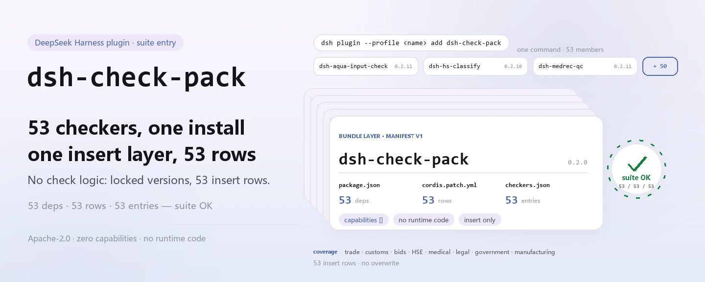

<div align="center">

<picture>
  <source media="(prefers-color-scheme: dark)" srcset="docs/assets/dsh-check-pack-hero-en-dark.webp">
  
</picture>

# dsh-check-pack

**Instala los 53 comprobadores de cumplimiento de PerryLink con un solo comando: una capa de bundle inserta las 53 filas de Cordis a la vez.**

El punto de entrada de la suite para comprobaciones documentales del dominio chino (comercio, aduanas, licitaciones, HSE, medicina, legal, administración pública, manufactura): cada comprobador conserva su nombre npm, su paquete de reglas y su versión; este paquete solo los trae juntos.

[Instalar](#instalación-en-tres-pasos) · [Configuración](#configuración) · [FAQ](#faq) · [简体中文](README.md) · [English](README.en.md) · [Español](README.es.md) · [Português](README.pt.md) · [हिन्दी](README.hi.md)

[](LICENSE)
[](#compatibilidad)
[](https://www.npmjs.com/package/dsh-check-pack)
[](https://github.com/PerryLink/dsh-check-pack/actions/workflows/ci.yml)
[](#compatibilidad)

[](https://github.com/PerryLink/dsh-check-pack/stargazers)
[](https://www.npmjs.com/package/dsh-check-pack)
[](https://dshfind.com/plugins/PerryLink/dsh-check-pack?ref=badge)
[](https://gitee.com/perrylink/dsh-check-pack)

```sh
dsh plugin --profile <name> add dsh-check-pack
```

</div>

<sub>Plugin de la comunidad, no afiliado a DeepSeek. Repositorio canónico: <https://github.com/PerryLink/dsh-check-pack> (Gitee es un espejo).</sub>

## Qué es

`dsh-check-pack` es el punto de entrada de la suite que instala **los 53 comprobadores de cumplimiento de PerryLink** con un solo comando. No contiene lógica de comprobación propia: el `cordis.patch.yml` incluido es una capa de bundle que hace `insert` de 53 filas de Cordis durante la instalación, conectando cada comprobador con el perfil activo en la versión fijada en `checkers.json`.

La lista de dependencias es la lista de miembros: 53 paquetes `dsh-*` con versiones exactas. Cada comprobador conserva su nombre npm, su paquete de reglas, su README y su versión; las actualizaciones y la configuración ocurren de su lado. Este paquete se llamaba antes [`@perrylink/dsh-checkers`](https://www.npmjs.com/package/@perrylink/dsh-checkers), ya obsoleto; ahora se llama `dsh-check-pack`, instálalo con el nombre nuevo.

El alcance son documentos del dominio chino: comercio, aduanas, licitaciones, HSE, medicina, legal, administración pública, manufactura. Cada comprobador solo señala diferencias dentro del material y **nunca emite una calificación legal, médica o aduanera**; la conclusión queda en el revisor.

<picture>
  <source media="(prefers-color-scheme: dark)" srcset="docs/assets/dsh-check-pack-flow-v5-dark.svg">
  
</picture>

## Instalación en tres pasos

1. **Instalar** (elige un canal):

   ```sh
   # canal npm (versiones publicadas)
   dsh plugin --profile web add dsh-check-pack
   # canal git (main más reciente; equivale a git+https://github.com/PerryLink/dsh-check-pack.git)
   dsh plugin --profile web add github:PerryLink/dsh-check-pack
   # canal tarball: npm pack en este repositorio y luego
   dsh plugin --profile web add ./dsh-check-pack-<version>.tgz
   ```

   > Según el registro de este repositorio: npm deja las versiones nuevas en aprobación 2FA; si `npm view dsh-check-pack version` no muestra la última versión, usa primero el canal git.

2. **Configuración mínima**: ninguna. La capa de bundle inserta las 53 filas con los valores por defecto de cada comprobador; para ajustar uno, cambia sus claves en su propio README: este paquete no tiene nada que configurar.

3. **Verificar que surtió efecto**:

   ```sh
   dsh --profile web --dump-config | grep -A1 'id: dsh-aqua-input-check'
   ```

   Ver cualquier fila de comprobador de la suite significa que la capa de bundle se expandió. También puedes ejecutar la puerta de consistencia en este repositorio:

   ```sh
   node verify.mjs
   # => suite OK: 53 rows, 53 dependencies
   ```

**Desinstalar**: `dsh plugin --profile web remove dsh-check-pack` quita la fila de la suite; los comprobadores que instalaste por separado necesitan su propio `remove`.

## Capacidades clave

- **Un comando, 53 comprobadores** — sin `add` uno por uno: un `insert` en `cordis.patch.yml` trae las 53 filas, así que instalar un paquete instala la suite completa.
- **Versiones exactas fijadas** — las 53 dependencias de `package.json` son versiones exactas; `checkers.json` registra los mismos `id` / `name` / `version`, y `verify.mjs` mantiene los tres de acuerdo.
- **Solo punto de entrada, sin dictamen** — este paquete no tiene código de comprobación y nunca lee ni escribe documentos de negocio; las reglas, las severidades y la redacción de los informes pertenecen a cada comprobador y no cambian aquí.
- **Sin capacidades ni registros** — `dsh.capabilities` es un arreglo vacío: sin herramientas, comandos, servicios, eventos ni rutas HTTP; solo las filas insertadas del bundle.
- **Manifiestos regenerables** — `node build.mjs` puede reconstruir las dependencias, `cordis.patch.yml` y `checkers.json` desde `../../checkers` en el espacio de trabajo; ese directorio no existe en el repositorio independiente, así que la regeneración es opcional.
- **Chequeo nocturno del upstream** — `checkers-nightly.yml` clona los 53 repositorios de comprobadores todos los días a las 18:00 UTC y ejecuta `pnpm run typecheck` y `pnpm test`; `ci.yml` ejecuta `node verify.mjs` y `npm pack --dry-run` en Node 22.

## Configuración

Este paquete no registra claves de configuración ni tiene un `Config` de Schemastery: lo único que hace es insertar 53 filas cuyo `id` / `name` son los nombres de los paquetes de los comprobadores, con `config` vacío para que cada uno use sus valores por defecto. Para ajustar parámetros, ve al README del comprobador correspondiente (por ejemplo `rulesFile`, `disabledRules`, `onlyRules` y `timeoutMs` en [`dsh-aqua-input-check`](https://github.com/PerryLink/dsh-aqua-input-check)); esas claves pertenecen a los comprobadores, no a este paquete.

Campos del manifiesto de este paquete:

| Campo | Valor | Significado |
|---|---|---|
| `dsh.manifestVersion` | `1` | versión del manifiesto de bundle |
| `dsh.bundle.patch` | `./cordis.patch.yml` | parche de bundle aplicado al instalar |
| `dsh.capabilities` | `[]` | no solicita ninguna capacidad del host |
| `engines.dsh` | `>=0.2.1-0 <0.3.0` | rango del runtime |
| `engines.node` | `^22.19.0 \|\| >=24.0.0` | rango de Node |
| `dependencies` | 53 versiones exactas | miembros de la suite y versiones fijadas |

<details>
<summary>Manifiesto completo de la suite (53 miembros, copiados literalmente de checkers.json)</summary>

| Paquete | Versión |
|---|---|
| `dsh-aqua-input-check` | `0.2.11` |
| `dsh-archive-check` | `0.2.9` |
| `dsh-bid-ca-precheck` | `0.2.11` |
| `dsh-bid-qual-check` | `0.2.10` |
| `dsh-contract-stance` | `0.2.9` |
| `dsh-customs-doc-check` | `0.2.8` |
| `dsh-demurrage-ledger` | `0.2.9` |
| `dsh-drill-script-check` | `0.2.8` |
| `dsh-eia-guide-check` | `0.2.9` |
| `dsh-emergency-plan` | `0.2.8` |
| `dsh-essay-rubric-check` | `0.2.8` |
| `dsh-evidence-check` | `0.2.11` |
| `dsh-export-ctl-check` | `0.2.11` |
| `dsh-fmea-table-check` | `0.2.8` |
| `dsh-forecast-penalty` | `0.2.8` |
| `dsh-gongwen-flow-check` | `0.2.9` |
| `dsh-gongwen-word-check` | `0.2.10` |
| `dsh-guard-plan-qc` | `0.2.8` |
| `dsh-hazchem-check` | `0.2.11` |
| `dsh-hazplan-check` | `0.2.10` |
| `dsh-hidden-risk-map` | `0.2.8` |
| `dsh-hs-classify` | `0.2.10` |
| `dsh-icd-rule-check` | `0.2.10` |
| `dsh-lawcite-adapter` | `0.2.10` |
| `dsh-lc-doc-check` | `0.2.9` |
| `dsh-learning-gap-check` | `0.2.8` |
| `dsh-medrec-qc` | `0.2.11` |
| `dsh-nsfc-form-check` | `0.2.10` |
| `dsh-nurse-record-check` | `0.2.10` |
| `dsh-origin-rvc-check` | `0.2.9` |
| `dsh-ota-review-check` | `0.2.10` |
| `dsh-paper-doc-adapter` | `0.2.8` |
| `dsh-permit-report-check` | `0.2.10` |
| `dsh-pipeline-check` | `0.2.8` |
| `dsh-pleading-draft` | `0.2.10` |
| `dsh-policy-brief-draft` | `0.2.10` |
| `dsh-power-loss-split` | `0.2.9` |
| `dsh-power-ticket-check` | `0.2.9` |
| `dsh-ppap-check` | `0.2.8` |
| `dsh-protest-deadline` | `0.2.10` |
| `dsh-railway-window` | `0.2.8` |
| `dsh-repair-order-qc` | `0.2.10` |
| `dsh-review-reply-check` | `0.2.8` |
| `dsh-rulefile-check` | `0.2.8` |
| `dsh-safety-brief-check` | `0.2.9` |
| `dsh-site-log-check` | `0.2.11` |
| `dsh-soe-decision-check` | `0.2.13` |
| `dsh-soilwater-check` | `0.2.8` |
| `dsh-sop-sync-check` | `0.2.8` |
| `dsh-spc-gbt-adapter` | `0.2.8` |
| `dsh-tender-extract` | `0.2.11` |
| `dsh-tender-matrix` | `0.2.12` |
| `dsh-warranty-calc` | `0.2.10` |

</details>

## FAQ

<details>
<summary>¿Todavía tengo que instalar los 53 comprobadores uno por uno?</summary>

No. Los 53 paquetes son dependencias de `dsh-check-pack`, se resuelven al instalar y la capa de bundle inserta las 53 filas de Cordis de una vez. Puedes seguir instalando un comprobador por separado: conserva su nombre npm y su versión, y el que instalaste aparte necesita su propio `remove` al desinstalar este paquete.

</details>

<details>
<summary>¿Por qué npm no me da la última versión?</summary>

Según el registro de este repositorio, npm deja las versiones nuevas en aprobación 2FA. Hasta que esa aprobación llegue, usa el canal git: `dsh plugin --profile web add github:PerryLink/dsh-check-pack`. La versión que está ahora en npm es `0.2.0`; compruébalo con `npm view dsh-check-pack version`.

</details>

<details>
<summary>¿Desinstalar elimina los 53 comprobadores?</summary>

`remove dsh-check-pack` quita la fila de la suite; este paquete y los 53 comprobadores son paquetes npm independientes. Si instalaste un comprobador por separado, quítalo por separado; si queda una fila de comprobador después de quitar la suite, comprueba primero si es la que instalaste tú.

</details>

<details>
<summary>¿Estos comprobadores dan un veredicto de cumple / no cumple?</summary>

No. Cada comprobador solo enumera las diferencias que puede señalar dentro del material (qué fila, qué columna, qué falta, cómo completarlo), no emite una calificación legal, médica o aduanera y no atribuye responsabilidad; la conclusión queda en el revisor. Este paquete solo instala los comprobadores y no cambia la redacción de sus informes.

</details>

<details>
<summary>¿Las 53 versiones pueden desviarse solas?</summary>

No hay desviación automática desde el upstream. Un `dsh-check-pack` publicado fija las 53 versiones en `package.json`; `checkers.json` y `cordis.patch.yml` registran el mismo conjunto, y `verify.mjs` comprueba que los tres coincidan (53 filas / 53 dependencias). Tras una publicación upstream hace falta regenerar con `node build.mjs` y publicar este paquete para seguirla; `checkers-nightly.yml` verifica cada noche que los repositorios upstream sigan pasando typecheck y test.

</details>

## Límites de seguridad

- **Sin dictamen.** Este paquete y los comprobadores que instala solo señalan diferencias: no emiten una calificación legal, médica o aduanera, y un informe no es prueba de cumplimiento.
- **Alcance acotado.** Solo documentos del dominio chino (comercio, aduanas, licitaciones, HSE, medicina, legal, administración pública, manufactura); los documentos fuera de ese alcance no están prometidos.
- **Este paquete no toca datos.** Solo incluye un manifiesto, un parche de bundle y archivos de manifiesto, sin código en tiempo de ejecución: no lee documentos, no hace peticiones de red, no escribe archivos y no registra herramientas ni comandos; `dsh.capabilities` está vacío.
- **El punto de entrada no cambia el comportamiento de los miembros.** Cada comprobador decide su paquete de reglas, sus severidades y su descargo de responsabilidad; instalar este paquete no relaja ni endurece ninguna regla.

## Limitaciones conocidas

- **La versión de la suite es una instantánea de publicación.** Las 53 dependencias se fijan al publicar; las correcciones upstream no entran en un paquete ya publicado: hay que regenerar y publicar este paquete para seguirlas.
- **Las publicaciones npm pasan por aprobación 2FA.** Según el registro de este repositorio, una versión nueva puede quedarse en la aprobación 2FA de npm; solo el canal git da el main más reciente.
- **No tiene configuración propia.** No puedes activar o desactivar un comprobador ni cambiar una severidad desde aquí; configúralo en el README de ese comprobador, o instala solo los que necesites.
- **Regenerar requiere el espacio de trabajo.** `build.mjs` lee `../../checkers`; un clon independiente de GitHub no tiene ese directorio, así que `verify.mjs` comprueba los manifiestos confirmados por defecto y la regeneración automática solo ocurre en el espacio de trabajo (`CHECK_BUILD=1` y el directorio presente).
- **El chequeo del upstream es asíncrono.** `checkers-nightly.yml` se ejecuta una vez por noche e informa del estado de los repositorios upstream ese día; no cambia lo que contiene un paquete publicado.
- **El nombre antiguo está obsoleto.** `@perrylink/dsh-checkers` es el nombre anterior; no lo instales: usa `dsh-check-pack` en npm.

## Interoperabilidad con otros plugins DSH

- **Solo insert, nunca sobrescribe.** Cada fila de `cordis.patch.yml` es un `insert`; nunca sobrescribe el `config` de una fila integrada ni de otro plugin. Los 53 id son nombres de paquetes `dsh-*`.
- **No registra ninguna superficie.** Este paquete no tiene código en tiempo de ejecución: no aporta service key, no registra herramienta / comando / slot de cliente / prefijo `webServer` y no modifica ningún objeto global.
- **Los miembros siguen siendo independientes.** Los 53 comprobadores son paquetes npm independientes que declaran sus propias dependencias y capacidades; este paquete no actúa como proxy de sus herramientas ni cambia cómo se registran.
- **Desinstalar es local.** `remove dsh-check-pack` quita solo la fila de la suite y el paquete; no toca las filas de otros plugins ni borra la configuración de nadie.

## Compatibilidad

| Dimensión | Estado |
|---|---|
| Harness | DSH `>=0.2.1-0 <0.3.0` (`engines.dsh`); versión del manifiesto de bundle `1` |
| Node | `^22.19.0 \|\| >=24.0.0` |
| Plataformas | Donde corra DSH (sin código nativo, sin peticiones de red) |
| Nombre del paquete | `dsh-check-pack` en npm; el anterior `@perrylink/dsh-checkers` está obsoleto |
| Versión npm | `0.2.0` |

## Ecosistema y calidad

- [Espejo en Gitee](https://gitee.com/perrylink/dsh-check-pack) (espejo sincronizado; GitHub es el canónico)
- [Página del plugin en dshfind](https://dshfind.com/plugins/PerryLink/dsh-check-pack) (instalaciones y ranking)
- [Página del paquete en npm](https://www.npmjs.com/package/dsh-check-pack) (versión y árbol de dependencias)
- [Flujo de CI](https://github.com/PerryLink/dsh-check-pack/actions/workflows/ci.yml) (`node verify.mjs` + `npm pack --dry-run`)
- [checkers-nightly](https://github.com/PerryLink/dsh-check-pack/actions/workflows/checkers-nightly.yml) (typecheck + test de cada upstream cada noche)
- [Base de conocimiento del ecosistema](https://perrylink.github.io/dsh-plugin-guide/): guía de desarrollo de plugins · datos de selección · criterios de mantenimiento

## Desarrollo

```sh
node verify.mjs              # 53 filas / 53 dependencias / versiones coincidentes; igual que CI
node build.mjs               # regenera los tres manifiestos (solo en el espacio de trabajo: ../../checkers)
npm pack --dry-run           # inspecciona el contenido publicado (CI también lo ejecuta)
python scripts/gen-readme-assets.py   # regenera las imágenes (Python + Pillow)
```

Sin paso de build ni dependencias en tiempo de ejecución: el paquete solo contiene un manifiesto, un parche y archivos de manifiesto, y `verify.mjs` / `build.mjs` usan solo módulos integrados de Node. `build.mjs` lee el `package.json` y el `cordis.patch.yml` de los 53 comprobadores desde `../../checkers` y reescribe las dependencias de `package.json`, `cordis.patch.yml` y `checkers.json`; un clon independiente no tiene ese directorio, así que regenerar es opcional.

Estructura:

| Ruta | Función |
|---|---|
| `package.json` | metadatos npm + 53 dependencias exactas + manifiesto de bundle |
| `cordis.patch.yml` | las 53 filas insertadas al instalar (generado) |
| `checkers.json` | lista `id` / `name` / `version` de los 53 comprobadores (generada) |
| `build.mjs` | reconstruye los tres archivos anteriores desde `../../checkers` |
| `verify.mjs` | puerta de consistencia: 53 / 53 / 53 + versiones coincidentes |
| `.github/workflows/ci.yml` | verify + pack dry-run en Node 22 |
| `.github/workflows/checkers-nightly.yml` | typecheck + test de cada upstream cada noche |
| `scripts/gen-readme-assets.py` | genera el diagrama de flujo claro/oscuro en `docs/assets/` |
| `docs/assets/` | imágenes del README |

Topics: `dsh-plugin`, `dsh-bundle`

## Familia y agradecimientos

Este proyecto forma parte de la familia de plugins de DeepSeek Harness de [PerryLink](https://github.com/PerryLink) (todos Apache-2.0). Si esta suite te resulta útil, **una estrella ayuda a que la siguiente persona la encuentre**; no desbloquea nada.

- [@PerryLink](https://github.com/PerryLink) — creador y mantenedor: el manifiesto de la suite de 53 comprobadores, la capa de bundle, las puertas `build.mjs` / `verify.mjs`, el chequeo nocturno del upstream y la documentación en cinco idiomas.

## Licencia

[LICENSE](LICENSE) (Apache License 2.0) © 2026 dsh-check-pack contributors

<p align="center"><sub>Apache-2.0 · Plugin de la comunidad, no afiliado a DeepSeek.</sub></p>
