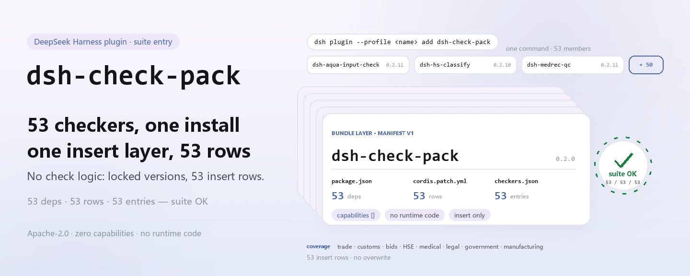

<div align="center">

<picture>
  <source media="(prefers-color-scheme: dark)" srcset="docs/assets/dsh-check-pack-hero-en-dark.webp">
  
</picture>

# dsh-check-pack

**एक ही कमांड से PerryLink के 53 अनुपालन जाँचकर्ता इंस्टॉल करें — एक bundle परत एक साथ 53 Cordis पंक्तियाँ जोड़ती है।**

चीनी दस्तावेज़ जाँच (व्यापार, सीमा शुल्क, निविदा, HSE, चिकित्सा, कानून, सरकार, विनिर्माण) के लिए सूट प्रवेश बिंदु: हर जाँचकर्ता अपना npm नाम, नियम पैक और संस्करण रखता है; यह पैकेज केवल उन्हें साथ लाता है।

[इंस्टॉल](#तीन-चरणों-में-शुरुआत) · [कॉन्फ़िगरेशन](#कॉन्फ़िगरेशन) · [FAQ](#faq) · [简体中文](README.md) · [English](README.en.md) · [Español](README.es.md) · [Português](README.pt.md) · [हिन्दी](README.hi.md)

[](LICENSE)
[](#संगतता)
[](https://www.npmjs.com/package/dsh-check-pack)
[](https://github.com/PerryLink/dsh-check-pack/actions/workflows/ci.yml)
[](#संगतता)

[](https://github.com/PerryLink/dsh-check-pack/stargazers)
[](https://www.npmjs.com/package/dsh-check-pack)
[](https://dshfind.com/plugins/PerryLink/dsh-check-pack?ref=badge)
[](https://gitee.com/perrylink/dsh-check-pack)

```sh
dsh plugin --profile <name> add dsh-check-pack
```

</div>

<sub>समुदाय प्लगइन, DeepSeek से संबद्ध नहीं। आधिकारिक रेपो: <https://github.com/PerryLink/dsh-check-pack> (Gitee प्रतिबिंब है)।</sub>

## यह क्या है

`dsh-check-pack` वह सूट प्रवेश बिंदु है जो **PerryLink के 53 अनुपालन जाँचकर्ताओं** को एक ही कमांड से इंस्टॉल करता है। इसमें अपनी कोई जाँच लॉजिक नहीं है: साथ भेजा गया `cordis.patch.yml` एक bundle परत है जो इंस्टॉल के समय 53 Cordis पंक्तियाँ `insert` करता है और हर जाँचकर्ता को `checkers.json` में तय संस्करण पर सक्रिय प्रोफ़ाइल से जोड़ता है।

निर्भरताओं की सूची ही सदस्य-सूची है — 53 `dsh-*` पैकेज, सटीक संस्करणों पर। हर जाँचकर्ता अपना npm नाम, नियम पैक, README और संस्करण रखता है; अपडेट और कॉन्फ़िगरेशन उसी की ओर होते हैं। यह पैकेज पहले अप्रचलित [`@perrylink/dsh-checkers`](https://www.npmjs.com/package/@perrylink/dsh-checkers) था; अब इसका नाम `dsh-check-pack` है, इसे नए नाम से इंस्टॉल करें।

दायरा चीनी दस्तावेज़ हैं: व्यापार, सीमा शुल्क, निविदा, HSE, चिकित्सा, कानून, सरकार, विनिर्माण। हर जाँचकर्ता केवल सामग्री के भीतर के अंतर बताता है और **कानूनी, चिकित्सीय या सीमा शुल्क निर्णय कभी नहीं देता**; निष्कर्ष समीक्षक के पास रहता है।

<picture>
  <source media="(prefers-color-scheme: dark)" srcset="docs/assets/dsh-check-pack-flow-v5-dark.svg">
  
</picture>

## तीन चरणों में शुरुआत

1. **इंस्टॉल करें** (एक चैनल चुनें):

   ```sh
   # npm चैनल (प्रकाशित संस्करण)
   dsh plugin --profile web add dsh-check-pack
   # git चैनल (नवीनतम main; git+https://github.com/PerryLink/dsh-check-pack.git के बराबर)
   dsh plugin --profile web add github:PerryLink/dsh-check-pack
   # tarball चैनल: इस रेपो में npm pack के बाद
   dsh plugin --profile web add ./dsh-check-pack-<version>.tgz
   ```

   > इस रेपो के रिकॉर्ड के अनुसार: npm नई संस्करणों को 2FA स्वीकृति के लिए रोकता है; यदि `npm view dsh-check-pack version` नवीनतम संस्करण न दिखाए, तो पहले git चैनल इस्तेमाल करें।

2. **न्यूनतम कॉन्फ़िगरेशन**: कोई नहीं। bundle परत सभी 53 पंक्तियाँ हर जाँचकर्ता के डिफ़ॉल्ट के साथ जोड़ती है; किसी एक को बदलना हो तो उसके अपने README में उसकी कुंजियाँ बदलें — इस पैकेज में कॉन्फ़िगर करने को कुछ नहीं है।

3. **प्रभावी हुआ सत्यापित करें**:

   ```sh
   dsh --profile web --dump-config | grep -A1 'id: dsh-aqua-input-check'
   ```

   सूट की कोई भी जाँचकर्ता पंक्ति दिखना मतलब bundle परत फैल गई। इस रेपो में consistency गेट भी चला सकते हैं:

   ```sh
   node verify.mjs
   # => suite OK: 53 rows, 53 dependencies
   ```

**अनइंस्टॉल**: `dsh plugin --profile web remove dsh-check-pack` सूट पंक्ति हटाता है; अलग से इंस्टॉल किए जाँचकर्ताओं के लिए अलग `remove` चाहिए।

## मुख्य क्षमताएँ

- **एक कमांड, 53 जाँचकर्ता** — एक-एक `add` नहीं: `cordis.patch.yml` में एक `insert` सभी 53 पंक्तियाँ लाता है, इसलिए एक पैकेज इंस्टॉल करने से पूरा सूट आ जाता है।
- **सटीक संस्करण पिन** — `package.json` की 53 निर्भरताएँ सटीक संस्करण हैं; `checkers.json` वही `id` / `name` / `version` दर्ज करता है, और `verify.mjs` तीनों को मिलाता है।
- **केवल प्रवेश बिंदु, कोई निर्णय नहीं** — इस पैकेज में जाँच कोड नहीं है और यह व्यावसायिक दस्तावेज़ न पढ़ता है न लिखता है; नियम, गंभीरता और रिपोर्ट की भाषा हर जाँचकर्ता की अपनी हैं और यहाँ नहीं बदलतीं।
- **शून्य क्षमताएँ, शून्य पंजीकरण** — `dsh.capabilities` खाली सरणी है: कोई टूल, कमांड, सेवा, ईवेंट या HTTP रूट नहीं; केवल bundle पंक्तियाँ।
- **पुनर्जनन योग्य मैनिफ़ेस्ट** — `node build.mjs` वर्कस्पेस में `../../checkers` से निर्भरताएँ, `cordis.patch.yml` और `checkers.json` फिर बना सकता है; स्वतंत्र रेपो में वह डायरेक्टरी नहीं होती, इसलिए पुनर्जनन वैकल्पिक है।
- **रात्रि upstream जाँच** — `checkers-nightly.yml` रोज़ 18:00 UTC पर सभी 53 जाँचकर्ता रेपो क्लोन कर `pnpm run typecheck` और `pnpm test` चलाता है; `ci.yml` Node 22 पर `node verify.mjs` और `npm pack --dry-run` चलाता है।

## कॉन्फ़िगरेशन

यह पैकेज अपनी कोई कॉन्फ़िगरेशन कुंजी पंजीकृत नहीं करता और इसका Schemastery `Config` नहीं है: यह केवल 53 पंक्तियाँ जोड़ता है जिनके `id` / `name` संबंधित जाँचकर्ता के पैकेज नाम हैं, और `config` खाली रहता है ताकि हर जाँचकर्ता अपने डिफ़ॉल्ट इस्तेमाल करे। पैरामीटर बदलने के लिए संबंधित जाँचकर्ता का README देखें (जैसे [`dsh-aqua-input-check`](https://github.com/PerryLink/dsh-aqua-input-check) में `rulesFile`, `disabledRules`, `onlyRules`, `timeoutMs`) — वे कुंजियाँ जाँचकर्ताओं की हैं, इस पैकेज की नहीं।

इस पैकेज के manifest फ़ील्ड:

| फ़ील्ड | मान | अर्थ |
|---|---|---|
| `dsh.manifestVersion` | `1` | bundle manifest संस्करण |
| `dsh.bundle.patch` | `./cordis.patch.yml` | इंस्टॉल पर लागू bundle पैच |
| `dsh.capabilities` | `[]` | होस्ट से कोई क्षमता नहीं माँगता |
| `engines.dsh` | `>=0.2.1-0 <0.3.0` | रनटाइम सीमा |
| `engines.node` | `^22.19.0 \|\| >=24.0.0` | Node सीमा |
| `dependencies` | 53 सटीक संस्करण | सूट सदस्य और पिन किए संस्करण |

<details>
<summary>पूरा सूट मैनिफ़ेस्ट (53 सदस्य, checkers.json से शब्दशः)</summary>

| पैकेज | संस्करण |
|---|---|
| `dsh-aqua-input-check` | `0.2.11` |
| `dsh-archive-check` | `0.2.9` |
| `dsh-bid-ca-precheck` | `0.2.11` |
| `dsh-bid-qual-check` | `0.2.10` |
| `dsh-contract-stance` | `0.2.9` |
| `dsh-customs-doc-check` | `0.2.8` |
| `dsh-demurrage-ledger` | `0.2.9` |
| `dsh-drill-script-check` | `0.2.8` |
| `dsh-eia-guide-check` | `0.2.9` |
| `dsh-emergency-plan` | `0.2.8` |
| `dsh-essay-rubric-check` | `0.2.8` |
| `dsh-evidence-check` | `0.2.11` |
| `dsh-export-ctl-check` | `0.2.11` |
| `dsh-fmea-table-check` | `0.2.8` |
| `dsh-forecast-penalty` | `0.2.8` |
| `dsh-gongwen-flow-check` | `0.2.9` |
| `dsh-gongwen-word-check` | `0.2.10` |
| `dsh-guard-plan-qc` | `0.2.8` |
| `dsh-hazchem-check` | `0.2.11` |
| `dsh-hazplan-check` | `0.2.10` |
| `dsh-hidden-risk-map` | `0.2.8` |
| `dsh-hs-classify` | `0.2.10` |
| `dsh-icd-rule-check` | `0.2.10` |
| `dsh-lawcite-adapter` | `0.2.10` |
| `dsh-lc-doc-check` | `0.2.9` |
| `dsh-learning-gap-check` | `0.2.8` |
| `dsh-medrec-qc` | `0.2.11` |
| `dsh-nsfc-form-check` | `0.2.10` |
| `dsh-nurse-record-check` | `0.2.10` |
| `dsh-origin-rvc-check` | `0.2.9` |
| `dsh-ota-review-check` | `0.2.10` |
| `dsh-paper-doc-adapter` | `0.2.8` |
| `dsh-permit-report-check` | `0.2.10` |
| `dsh-pipeline-check` | `0.2.8` |
| `dsh-pleading-draft` | `0.2.10` |
| `dsh-policy-brief-draft` | `0.2.10` |
| `dsh-power-loss-split` | `0.2.9` |
| `dsh-power-ticket-check` | `0.2.9` |
| `dsh-ppap-check` | `0.2.8` |
| `dsh-protest-deadline` | `0.2.10` |
| `dsh-railway-window` | `0.2.8` |
| `dsh-repair-order-qc` | `0.2.10` |
| `dsh-review-reply-check` | `0.2.8` |
| `dsh-rulefile-check` | `0.2.8` |
| `dsh-safety-brief-check` | `0.2.9` |
| `dsh-site-log-check` | `0.2.11` |
| `dsh-soe-decision-check` | `0.2.13` |
| `dsh-soilwater-check` | `0.2.8` |
| `dsh-sop-sync-check` | `0.2.8` |
| `dsh-spc-gbt-adapter` | `0.2.8` |
| `dsh-tender-extract` | `0.2.11` |
| `dsh-tender-matrix` | `0.2.12` |
| `dsh-warranty-calc` | `0.2.10` |

</details>

## FAQ

<details>
<summary>क्या मुझे 53 जाँचकर्ता एक-एक करके इंस्टॉल करने होंगे?</summary>

नहीं। सभी 53 पैकेज `dsh-check-pack` की निर्भरताएँ हैं, इंस्टॉल पर हल होते हैं, और bundle परत एक साथ 53 Cordis पंक्तियाँ जोड़ती है। आप एक जाँचकर्ता अलग से भी इंस्टॉल कर सकते हैं: वह अपना npm नाम और संस्करण रखता है, और अलग से इंस्टॉल किए गए को इस पैकेज को हटाते समय अलग `remove` चाहिए।

</details>

<details>
<summary>npm मुझे नवीनतम संस्करण क्यों नहीं देता?</summary>

इस रेपो के रिकॉर्ड के अनुसार, npm नई संस्करणों को 2FA स्वीकृति के लिए रोकता है। वह स्वीकृति आने तक git चैनल इस्तेमाल करें: `dsh plugin --profile web add github:PerryLink/dsh-check-pack`। अभी npm पर संस्करण `0.2.0` है; `npm view dsh-check-pack version` से जाँचें।

</details>

<details>
<summary>क्या अनइंस्टॉल सभी 53 जाँचकर्ता हटा देता है?</summary>

`remove dsh-check-pack` सूट पंक्ति हटाता है; यह पैकेज और 53 जाँचकर्ता स्वतंत्र npm पैकेज हैं। यदि आपने कोई जाँचकर्ता अलग से इंस्टॉल किया था, उसे अलग से हटाएँ; सूट हटने के बाद भी कोई जाँचकर्ता पंक्ति दिखे तो पहले जाँचें कि वह आपके द्वारा अलग से इंस्टॉल किया गया वाला है या नहीं।

</details>

<details>
<summary>क्या ये जाँचकर्ता «अनुपालन / अनुपालन नहीं» का निर्णय देते हैं?</summary>

नहीं। हर जाँचकर्ता केवल सामग्री के भीतर बताई जा सकने वाली असमानताएँ सूचीबद्ध करता है (कौन-सी पंक्ति, कौन-सा कॉलम, क्या कम है, कैसे पूरा करें), कोई कानूनी, चिकित्सीय या सीमा शुल्क निर्णय नहीं देता और कोई दायित्व नहीं ठहराता; निष्कर्ष समीक्षक के पास रहता है। यह पैकेज केवल जाँचकर्ता इंस्टॉल करता है और उनकी रिपोर्ट की भाषा नहीं बदलता।

</details>

<details>
<summary>क्या 53 संस्करण अपने आप बदल सकते हैं?</summary>

upstream से अपने आप कोई बदलाव नहीं आता। प्रकाशित `dsh-check-pack` 53 संस्करणों को `package.json` में पिन करता है; `checkers.json` और `cordis.patch.yml` वही समूह दर्ज करते हैं, और `verify.mjs` जाँचता है कि तीनों मेल खाते हैं (53 पंक्तियाँ / 53 निर्भरताएँ)। upstream की नई रिलीज़ के बाद `node build.mjs` से पुनर्जनन कर यह पैकेज प्रकाशित करना पड़ता है; `checkers-nightly.yml` हर रात जाँचता है कि upstream रेपो अब भी typecheck और test पास करते हैं।

</details>

## सुरक्षा सीमाएँ

- **कोई निर्णय नहीं।** यह पैकेज और इसके द्वारा इंस्टॉल जाँचकर्ता केवल अंतर बताते हैं: कोई कानूनी, चिकित्सीय या सीमा शुल्क निर्णय नहीं, और रिपोर्ट अनुपालन का प्रमाण नहीं है।
- **सीमित दायरा।** केवल चीनी दस्तावेज़ (व्यापार, सीमा शुल्क, निविदा, HSE, चिकित्सा, कानून, सरकार, विनिर्माण); इस दायरे से बाहर के दस्तावेज़ वादे में नहीं हैं।
- **यह पैकेज डेटा को नहीं छूता।** इसमें केवल manifest, bundle पैच और manifest फ़ाइलें हैं, कोई रनटाइम कोड नहीं: यह दस्तावेज़ नहीं पढ़ता, नेटवर्क अनुरोध नहीं करता, फ़ाइल नहीं लिखता और कोई टूल या कमांड पंजीकृत नहीं करता; `dsh.capabilities` खाली है।
- **प्रवेश बिंदु सदस्यों का व्यवहार नहीं बदलता।** हर जाँचकर्ता अपने नियम पैक, गंभीरता और अस्वीकरण स्वयं तय करता है; यह पैकेज इंस्टॉल करने से कोई नियम न ढीला होता है न कड़ा।

## ज्ञात सीमाएँ

- **सूट संस्करण रिलीज़ का स्नैपशॉट है।** 53 निर्भरताएँ रिलीज़ के समय पिन होती हैं; upstream सुधार पहले से प्रकाशित पैकेज में नहीं आते — उन्हें पाने के लिए पुनर्जनन और इस पैकेज का पुनः प्रकाशन चाहिए।
- **npm रिलीज़ 2FA स्वीकृति से गुज़रती हैं।** इस रेपो के रिकॉर्ड के अनुसार नई संस्करण npm की 2FA स्वीकृति में रुक सकती है; सबसे नया main केवल git चैनल देता है।
- **इसकी अपनी कोई कॉन्फ़िगरेशन नहीं।** यहाँ से आप किसी जाँचकर्ता को चालू/बंद या उसकी गंभीरता नहीं बदल सकते; उस जाँचकर्ता के README में कॉन्फ़िगर करें, या केवल ज़रूरी जाँचकर्ता इंस्टॉल करें।
- **पुनर्जनन के लिए वर्कस्पेस चाहिए।** `build.mjs` `../../checkers` पढ़ता है; स्वतंत्र GitHub क्लोन में वह डायरेक्टरी नहीं होती, इसलिए `verify.mjs` डिफ़ॉल्ट रूप से कमिट किए मैनिफ़ेस्ट जाँचता है और स्वचालित पुनर्जनन केवल वर्कस्पेस में होता है (`CHECK_BUILD=1` और डायरेक्टरी मौजूद हो)।
- **upstream जाँच अतुल्यकालिक है।** `checkers-nightly.yml` रात में एक बार चलता है और उस दिन upstream रेपो की स्थिति बताता है; यह नहीं बदलता कि प्रकाशित पैकेज में क्या है।
- **पुराना नाम अप्रचलित है।** `@perrylink/dsh-checkers` पुराना नाम है; इसे इंस्टॉल न करें — npm पर `dsh-check-pack` इस्तेमाल करें।

## अन्य DSH प्लगइनों के साथ इंटरऑपरेबिलिटी

- **केवल insert, कभी अधिलेखन नहीं।** `cordis.patch.yml` की हर पंक्ति `insert` है; यह किसी अंतर्निहित पंक्ति या अन्य प्लगइन के `config` को कभी नहीं लिखती। सभी 53 id `dsh-*` पैकेज नाम हैं।
- **कोई सतह पंजीकृत नहीं।** इस पैकेज में रनटाइम कोड नहीं है: यह service key नहीं देता, कोई टूल / कमांड / क्लाइंट slot / `webServer` उपसर्ग पंजीकृत नहीं करता और कोई ग्लोबल ऑब्जेक्ट नहीं बदलता।
- **सदस्य स्वतंत्र रहते हैं।** 53 जाँचकर्ता स्वतंत्र npm पैकेज हैं जो अपनी निर्भरताएँ और क्षमताएँ स्वयं घोषित करते हैं; यह पैकेज उनके टूल का प्रॉक्सी नहीं है और उनके पंजीकरण का तरीका नहीं बदलता।
- **अनइंस्टॉल स्थानीय है।** `remove dsh-check-pack` केवल सूट पंक्ति और पैकेज हटाता है; यह अन्य प्लगइन की पंक्तियाँ नहीं छूता और किसी की कॉन्फ़िगरेशन नहीं मिटाता।

## संगतता

| आयाम | स्थिति |
|---|---|
| Harness | DSH `>=0.2.1-0 <0.3.0` (`engines.dsh`); bundle manifest संस्करण `1` |
| Node | `^22.19.0 \|\| >=24.0.0` |
| प्लेटफ़ॉर्म | जहाँ DSH चलता है (कोई नेटिव कोड नहीं, कोई नेटवर्क अनुरोध नहीं) |
| पैकेज नाम | npm पर `dsh-check-pack`; पुराना `@perrylink/dsh-checkers` अप्रचलित है |
| npm संस्करण | `0.2.0` |

## इकोसिस्टम और गुणवत्ता

- [Gitee प्रतिबिंब](https://gitee.com/perrylink/dsh-check-pack) (समन्वित प्रतिबिंब; GitHub आधिकारिक है)
- [dshfind प्लगइन पृष्ठ](https://dshfind.com/plugins/PerryLink/dsh-check-pack) (इंस्टॉल और रैंकिंग)
- [npm पैकेज पृष्ठ](https://www.npmjs.com/package/dsh-check-pack) (संस्करण और निर्भरता वृक्ष)
- [CI वर्कफ़्लो](https://github.com/PerryLink/dsh-check-pack/actions/workflows/ci.yml) (`node verify.mjs` + `npm pack --dry-run`)
- [checkers-nightly](https://github.com/PerryLink/dsh-check-pack/actions/workflows/checkers-nightly.yml) (हर रात प्रत्येक upstream का typecheck + test)
- [इकोसिस्टम ज्ञानकोश](https://perrylink.github.io/dsh-plugin-guide/): प्लगइन विकास मार्गदर्शिका · चयन डेटा · रखरखाव के मानदंड

## डेवलपमेंट

```sh
node verify.mjs              # 53 पंक्तियाँ / 53 निर्भरताएँ / संस्करण मेल; CI जैसा
node build.mjs               # तीनों मैनिफ़ेस्ट फिर बनाता है (केवल वर्कस्पेस: ../../checkers)
npm pack --dry-run           # प्रकाशित सामग्री जाँचें (CI भी चलाता है)
python scripts/gen-readme-assets.py   # चित्र फिर बनाएँ (Python + Pillow)
```

कोई build चरण नहीं, कोई रनटाइम निर्भरता नहीं: पैकेज में केवल manifest, पैच और manifest फ़ाइलें हैं, और `verify.mjs` / `build.mjs` केवल Node के अंतर्निहित मॉड्यूल इस्तेमाल करते हैं। `build.mjs` `../../checkers` से 53 जाँचकर्ताओं का `package.json` और `cordis.patch.yml` पढ़कर `package.json` की निर्भरताएँ, `cordis.patch.yml` और `checkers.json` फिर लिखता है; स्वतंत्र क्लोन में वह डायरेक्टरी नहीं होती, इसलिए पुनर्जनन वैकल्पिक है।

लेआउट:

| पथ | कार्य |
|---|---|
| `package.json` | npm मेटाडेटा + 53 सटीक निर्भरताएँ + bundle manifest |
| `cordis.patch.yml` | इंस्टॉल पर जोड़ी जाने वाली 53 पंक्तियाँ (जनित) |
| `checkers.json` | 53 जाँचकर्ताओं की `id` / `name` / `version` सूची (जनित) |
| `build.mjs` | ऊपर की तीनों फ़ाइलें `../../checkers` से फिर बनाता है |
| `verify.mjs` | consistency गेट: 53 / 53 / 53 + संस्करण मेल |
| `.github/workflows/ci.yml` | Node 22 पर verify + pack dry-run |
| `.github/workflows/checkers-nightly.yml` | हर रात प्रत्येक upstream का typecheck + test |
| `scripts/gen-readme-assets.py` | `docs/assets/` में हल्का/गहरा फ़्लो डायग्राम बनाता है |
| `docs/assets/` | README चित्र |

Topics: `dsh-plugin`, `dsh-bundle`

## परिवार और आभार

यह परियोजना [PerryLink](https://github.com/PerryLink) द्वारा अनुरक्षित DeepSeek Harness प्लगइन परिवार का हिस्सा है (सभी Apache-2.0)। यदि यह सूट उपयोगी लगे, तो **एक star अगले व्यक्ति को इसे ढूँढने में मदद करता है**; इससे कोई सुविधा खुलती नहीं।

- [@PerryLink](https://github.com/PerryLink) — निर्माता और अनुरक्षक: 53 जाँचकर्ताओं का सूट मैनिफ़ेस्ट, bundle परत, `build.mjs` / `verify.mjs` गेट, रात्रि upstream जाँच और पाँच भाषाओं का दस्तावेज़।

## लाइसेंस

[LICENSE](LICENSE) (Apache License 2.0) © 2026 dsh-check-pack contributors

<p align="center"><sub>Apache-2.0 · समुदाय प्लगइन, DeepSeek से संबद्ध नहीं।</sub></p>
