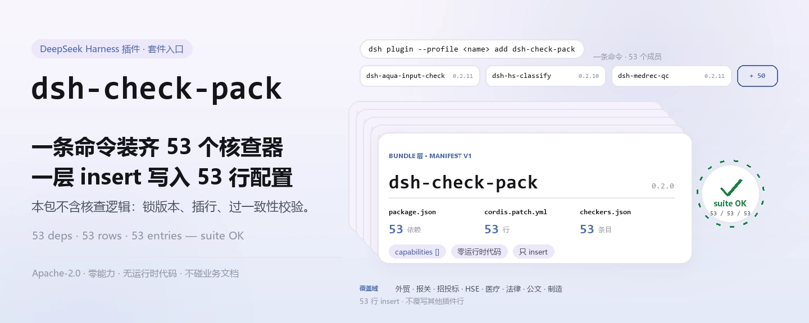
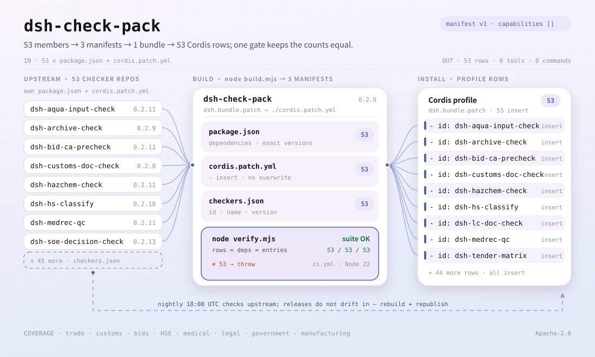

<div align="center">

<picture>
  <source media="(prefers-color-scheme: dark)" srcset="docs/assets/dsh-check-pack-hero-zh-dark.webp">
  
</picture>

# dsh-check-pack

**一条命令装齐 53 个 PerryLink 合规核查器——一层 bundle 同时插入 53 行 Cordis 配置。**

面向中国领域文档核对（外贸、报关、招投标、HSE、医疗、法律、公文、制造）的套件入口：每个核查器保留自己的 npm 名、规则包和版本，本包只负责把它们一起装进来。

[安装](#三步上手) · [配置](#配置) · [FAQ](#faq) · [简体中文](README.md) · [English](README.en.md) · [Español](README.es.md) · [Português](README.pt.md) · [हिन्दी](README.hi.md)

[](LICENSE)
[](#兼容性)
[](https://www.npmjs.com/package/dsh-check-pack)
[](https://github.com/PerryLink/dsh-check-pack/actions/workflows/ci.yml)
[](#兼容性)

[](https://github.com/PerryLink/dsh-check-pack/stargazers)
[](https://www.npmjs.com/package/dsh-check-pack)
[](https://dshfind.com/plugins/PerryLink/dsh-check-pack?ref=badge)
[](https://gitee.com/perrylink/dsh-check-pack)

```sh
dsh plugin --profile <name> add dsh-check-pack
```

</div>

<sub>社区插件，与 DeepSeek 官方无关。唯一仓库：<https://github.com/PerryLink/dsh-check-pack>（Gitee 为镜像）。</sub>

## 它是什么

`dsh-check-pack` 是**一条命令装齐 53 个 PerryLink 合规核查器**的套件入口。它自己不包含核查逻辑：随包的 `cordis.patch.yml` 是一层 bundle patch，安装时一次 `insert` 写入 53 行 Cordis 配置，把每个核查器按 `checkers.json` 里锁定的版本接进当前 profile。

包的依赖列表就是套件成员表——53 个 `dsh-*` 包，版本精确锁定；每个核查器仍保留自己的 npm 名、规则包、README 与版本，升级与配置都在它自己那边完成。本包前身是已弃用的 [`@perrylink/dsh-checkers`](https://www.npmjs.com/package/@perrylink/dsh-checkers)，现已更名为 `dsh-check-pack`，请按新名安装。

核对范围是中国领域文档：外贸、报关、招投标、HSE、医疗、法律、公文、制造。每个核查器只提示材料内部的差异，**不作法律、医疗或海关定性**——结论留给审核人。

<picture>
  <source media="(prefers-color-scheme: dark)" srcset="docs/assets/dsh-check-pack-flow-v5-dark.svg">
  
</picture>

## 三步上手

1. **安装**（三选一）：

   ```sh
   # npm 通道（已发布版本）
   dsh plugin --profile web add dsh-check-pack
   # git 通道（最新 main；等价于 git+https://github.com/PerryLink/dsh-check-pack.git）
   dsh plugin --profile web add github:PerryLink/dsh-check-pack
   # tarball 通道：本仓库 npm pack 后
   dsh plugin --profile web add ./dsh-check-pack-<version>.tgz
   ```

   > 按本仓记录：npm 对新版本有 2FA 暂存审批；`npm view dsh-check-pack version` 看不到最新版本时，先用 git 通道。

2. **最小配置**：不需要。安装后 53 行配置由 bundle patch 一次插入，全部走各核查器的默认值；要调某个核查器的参数，去它自己的 README 改它自己的键——本包没有可配项。

3. **验证已生效**：

   ```sh
   dsh --profile web --dump-config | grep -A1 'id: dsh-aqua-input-check'
   ```

   能看到套件里的任意一个核查器行，就说明 bundle 层已经展开。也可以在本仓库跑一致性门禁：

   ```sh
   node verify.mjs
   # => suite OK: 53 rows, 53 dependencies
   ```

**卸载**：`dsh plugin --profile web remove dsh-check-pack` 移除套件行；当初单独装过的核查器仍需逐个 `remove`。

## 核心能力

- **一条命令，53 个核查器** —— 不用逐个 `add`：`cordis.patch.yml` 一层 `insert` 写入 53 行，装一个包等于装齐整套。
- **版本精确锁定** —— `package.json` 的 53 个依赖全部写成精确版本，`checkers.json` 记录同一组 `id` / `name` / `version`，三者由 `verify.mjs` 互相对齐。
- **只做入口，不做裁决** —— 本包不含核查代码、不读写业务文档；规则、严重级与报告措辞都属于各核查器，本包不改变它们的行为。
- **零能力、零注册** —— `dsh.capabilities` 是空数组：本包不注册工具、命令、服务、事件或 HTTP 路由，只插入 bundle 行。
- **可重建的清单** —— `node build.mjs` 能从工作区的 `../../checkers` 重新生成依赖、`cordis.patch.yml` 与 `checkers.json`；独立仓库里没有该目录，重建是可选的。
- **每晚体检上游** —— `checkers-nightly.yml` 每天 18:00 UTC 逐个克隆 53 个核查器仓库，跑 `pnpm run typecheck` 与 `pnpm test`；`ci.yml` 则在 Node 22 上跑 `node verify.mjs` 与 `npm pack --dry-run`。

## 配置

本包不注册自己的配置键，也没有 Schemastery `Config`：它唯一做的事是插入 53 行，每行的 `id` / `name` 就是对应核查器的包名，`config` 留空即走该核查器的默认值。要调参数，请到对应核查器的 README（例如 [`dsh-aqua-input-check`](https://github.com/PerryLink/dsh-aqua-input-check) 的 `rulesFile`、`disabledRules`、`onlyRules`、`timeoutMs`）——那些键属于核查器，不属于本包。

本包自己的 manifest 字段：

| 字段 | 值 | 含义 |
|---|---|---|
| `dsh.manifestVersion` | `1` | bundle manifest 版本 |
| `dsh.bundle.patch` | `./cordis.patch.yml` | 安装时应用的 bundle 补丁 |
| `dsh.capabilities` | `[]` | 不向宿主申请任何能力 |
| `engines.dsh` | `>=0.2.1-0 <0.3.0` | 运行时区间 |
| `engines.node` | `^22.19.0 \|\| >=24.0.0` | Node 区间 |
| `dependencies` | 53 个精确版本 | 套件成员与锁定版本 |

<details>
<summary>完整套件清单（53 个成员，逐字取自 checkers.json）</summary>

| 包 | 版本 |
|---|---|
| `dsh-aqua-input-check` | `0.2.11` |
| `dsh-archive-check` | `0.2.9` |
| `dsh-bid-ca-precheck` | `0.2.11` |
| `dsh-bid-qual-check` | `0.2.10` |
| `dsh-contract-stance` | `0.2.9` |
| `dsh-customs-doc-check` | `0.2.8` |
| `dsh-demurrage-ledger` | `0.2.9` |
| `dsh-drill-script-check` | `0.2.8` |
| `dsh-eia-guide-check` | `0.2.9` |
| `dsh-emergency-plan` | `0.2.8` |
| `dsh-essay-rubric-check` | `0.2.8` |
| `dsh-evidence-check` | `0.2.11` |
| `dsh-export-ctl-check` | `0.2.11` |
| `dsh-fmea-table-check` | `0.2.8` |
| `dsh-forecast-penalty` | `0.2.8` |
| `dsh-gongwen-flow-check` | `0.2.9` |
| `dsh-gongwen-word-check` | `0.2.10` |
| `dsh-guard-plan-qc` | `0.2.8` |
| `dsh-hazchem-check` | `0.2.11` |
| `dsh-hazplan-check` | `0.2.10` |
| `dsh-hidden-risk-map` | `0.2.8` |
| `dsh-hs-classify` | `0.2.10` |
| `dsh-icd-rule-check` | `0.2.10` |
| `dsh-lawcite-adapter` | `0.2.10` |
| `dsh-lc-doc-check` | `0.2.9` |
| `dsh-learning-gap-check` | `0.2.8` |
| `dsh-medrec-qc` | `0.2.11` |
| `dsh-nsfc-form-check` | `0.2.10` |
| `dsh-nurse-record-check` | `0.2.10` |
| `dsh-origin-rvc-check` | `0.2.9` |
| `dsh-ota-review-check` | `0.2.10` |
| `dsh-paper-doc-adapter` | `0.2.8` |
| `dsh-permit-report-check` | `0.2.10` |
| `dsh-pipeline-check` | `0.2.8` |
| `dsh-pleading-draft` | `0.2.10` |
| `dsh-policy-brief-draft` | `0.2.10` |
| `dsh-power-loss-split` | `0.2.9` |
| `dsh-power-ticket-check` | `0.2.9` |
| `dsh-ppap-check` | `0.2.8` |
| `dsh-protest-deadline` | `0.2.10` |
| `dsh-railway-window` | `0.2.8` |
| `dsh-repair-order-qc` | `0.2.10` |
| `dsh-review-reply-check` | `0.2.8` |
| `dsh-rulefile-check` | `0.2.8` |
| `dsh-safety-brief-check` | `0.2.9` |
| `dsh-site-log-check` | `0.2.11` |
| `dsh-soe-decision-check` | `0.2.13` |
| `dsh-soilwater-check` | `0.2.8` |
| `dsh-sop-sync-check` | `0.2.8` |
| `dsh-spc-gbt-adapter` | `0.2.8` |
| `dsh-tender-extract` | `0.2.11` |
| `dsh-tender-matrix` | `0.2.12` |
| `dsh-warranty-calc` | `0.2.10` |

</details>

## FAQ

<details>
<summary>装了这个包，还需要逐个安装 53 个核查器吗？</summary>

不需要。`dsh-check-pack` 的依赖里就是这 53 个包，安装时一并解析，bundle patch 一次插入 53 行 Cordis 配置。你也可以单独安装某一个核查器——它保留自己的 npm 名与版本，卸载本包时单独装过的那一个仍需单独移除。

</details>

<details>
<summary>npm 上装不到最新版本？</summary>

按本仓记录，npm 会在发布新版本时走 2FA 暂存审批；审批落地前，用 git 通道安装最新 main：`dsh plugin --profile web add github:PerryLink/dsh-check-pack`。当前 npm 上的版本是 `0.2.0`，可用 `npm view dsh-check-pack version` 核对。

</details>

<details>
<summary>卸载会把 53 个核查器一起删掉吗？</summary>

`remove dsh-check-pack` 移除的是套件行；本包与 53 个核查器都是独立的 npm 包。如果你当初单独安装过某个核查器，它需要单独 `remove`；套件行消失后仍看到某个核查器行，先确认它是不是你另外装过的那一个。

</details>

<details>
<summary>这些核查器会给出「合规 / 不合规」的结论吗？</summary>

不会。每个核查器只列出材料内部能逐条指认的差异（哪一行、哪一栏、差什么、怎么补），不作法律、医疗或海关定性，也不判断责任；结论留给审核人。本包只负责把核查器装齐，不改变它们的报告口径。

</details>

<details>
<summary>53 个插件的版本会不会自己漂移？</summary>

不会随上游自动漂移。发布出去的 `dsh-check-pack` 把 53 个版本写死在 `package.json` 里，`checkers.json` 与 `cordis.patch.yml` 记录同一组值，`verify.mjs` 校验三者一致（53 行 / 53 个依赖）。上游发新版后，需要重新 `node build.mjs` 再发布本包才会跟上；`checkers-nightly.yml` 每晚验证上游仓库仍能通过 typecheck 与测试。

</details>

## 安全边界

- **不做定性。** 本包与它装入的核查器都只提示差异：不作法律、医疗或海关定性，报告不是合规证明。
- **范围有界。** 只面向中国领域文档（外贸、报关、招投标、HSE、医疗、法律、公文、制造）；超出这个范围的文档不在承诺内。
- **本包不碰数据。** 包内只有 manifest、bundle patch 与清单文件，没有运行时代码：不读文档、不联网、不写文件、不注册工具或命令，`dsh.capabilities` 为空。
- **入口不改变成员行为。** 每个核查器的规则包、严重级与免责声明由它自己决定；安装本包不会放宽或收紧任何一条规则。

## 已知限制

- **套件版本是发布快照。** 53 个依赖在发布时锁定；上游修复不会自动进入已发布的包，需要重新生成并发布本包。
- **npm 发布有 2FA 暂存。** 按本仓记录，新版本可能先停在 npm 的 2FA 审批；git 通道拿到的才是最新 main。
- **本包没有配置项。** 不能在这里统一开关某个核查器或改严重级；请到对应核查器的 README 配置，或只安装你需要的那几个。
- **重建依赖工作区。** `build.mjs` 读取 `../../checkers`；独立克隆的 GitHub 仓库没有该目录，因此 `verify.mjs` 默认只校验已提交的清单，自动重建只在工作区发生（`CHECK_BUILD=1` 且目录存在时才重建并 diff）。
- **上游体检是异步的。** `checkers-nightly.yml` 每晚跑一次，报告的是上游仓库当天的状态，不改变已发布本包的内容。
- **前身包已弃用。** `@perrylink/dsh-checkers` 是旧名，不要再安装；npm 上以 `dsh-check-pack` 为准。

## 与其他 DSH 插件的互操作性

- **只 insert，不覆写。** `cordis.patch.yml` 的每一行都是 `insert`，从不覆写内置行或其他插件的 `config`；53 个 id 全部是 `dsh-*` 包名。
- **不注册任何表面。** 本包没有运行时代码：不提供 service key、不注册工具 / 命令 / 客户端 slot / `webServer` 前缀，也不改全局对象。
- **成员各自独立。** 53 个核查器是独立 npm 包，各自声明自己的依赖与能力；本包不代理它们的工具，也不改变它们的注册方式。
- **卸载不伤及别人。** `remove dsh-check-pack` 只移除套件行与包自身，不改动其他插件行、不删除别人的配置。

## 兼容性

| 维度 | 状态 |
|---|---|
| Harness | DSH `>=0.2.1-0 <0.3.0`（`engines.dsh`）；bundle manifest 版本 `1` |
| Node | `^22.19.0 \|\| >=24.0.0` |
| 平台 | 任何 DSH 可运行处（本包无原生代码、无网络请求） |
| 包名 | `dsh-check-pack`（npm）；前身 `@perrylink/dsh-checkers` 已弃用 |
| npm 版本 | `0.2.0` |

## 生态与质量

- [Gitee 镜像](https://gitee.com/perrylink/dsh-check-pack)（同步镜像，以 GitHub 为准）
- [dshfind 插件页](https://dshfind.com/plugins/PerryLink/dsh-check-pack)（安装量与排名）
- [npm 包页](https://www.npmjs.com/package/dsh-check-pack)（版本与依赖树）
- [CI 工作流](https://github.com/PerryLink/dsh-check-pack/actions/workflows/ci.yml)（`node verify.mjs` + `npm pack --dry-run`）
- [checkers-nightly](https://github.com/PerryLink/dsh-check-pack/actions/workflows/checkers-nightly.yml)（每晚逐个上游 typecheck + test）
- [生态实测知识库](https://perrylink.github.io/dsh-plugin-guide/)：插件开发指南 · 选型实测数据 · 维护取舍判据

## 开发

```sh
node verify.mjs              # 53 行 / 53 个依赖 / 版本对齐；CI 同款
node build.mjs               # 仅在工作区（../../checkers 存在）重建三个清单文件
npm pack --dry-run           # 检查发布内容（CI 也会跑）
python scripts/gen-readme-assets.py   # 重新生成配图（Python + Pillow）
```

无构建步骤、无运行时依赖：包内只有 manifest、patch 与清单，`verify.mjs` / `build.mjs` 只用 Node 内置模块。`build.mjs` 从 `../../checkers` 读取 53 个核查器的 `package.json` 与 `cordis.patch.yml`，重写 `package.json` 的依赖、`cordis.patch.yml` 与 `checkers.json`；独立仓库没有该目录，所以重建是 opt-in。

目录布局：

| 路径 | 作用 |
|---|---|
| `package.json` | npm 元数据 + 53 个精确依赖 + bundle manifest |
| `cordis.patch.yml` | 安装时插入的 53 行（生成物） |
| `checkers.json` | 53 个核查器的 `id` / `name` / `version` 清单（生成物） |
| `build.mjs` | 从 `../../checkers` 重建上述三个文件 |
| `verify.mjs` | 一致性门禁：53 / 53 / 53 + 版本对齐 |
| `.github/workflows/ci.yml` | Node 22 上 verify + pack dry-run |
| `.github/workflows/checkers-nightly.yml` | 每晚逐个上游 typecheck + test |
| `scripts/gen-readme-assets.py` | 程序化生成 `docs/assets/` 下的深浅双版流程图 |
| `docs/assets/` | README 配图 |

Topics：`dsh-plugin`、`dsh-bundle`

## 家族与致谢

本项目是 [PerryLink](https://github.com/PerryLink) 维护的 DeepSeek Harness 插件家族成员（全部 Apache-2.0）。如果这个套件帮到了你，**给个 star**——它不解锁任何功能，但会让下一个人更容易找到它。

- [@PerryLink](https://github.com/PerryLink) —— 创建者与维护者：53 个合规核查器的套件清单、bundle 层、`build.mjs` / `verify.mjs` 门禁、每晚上游体检与五语文档。

## License

[LICENSE](LICENSE)（Apache License 2.0）© 2026 dsh-check-pack contributors

<p align="center"><sub>Apache-2.0 · 社区插件，与 DeepSeek 无关。</sub></p>
