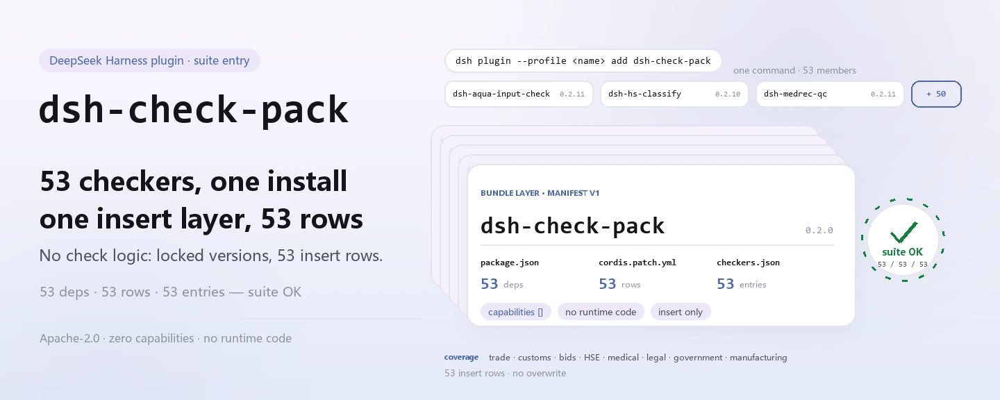

<div align="center">

<picture>
  <source media="(prefers-color-scheme: dark)" srcset="docs/assets/dsh-check-pack-hero-en-dark.webp">
  
</picture>

# dsh-check-pack

**Instale os 53 verificadores de conformidade da PerryLink com um único comando: uma camada de bundle insere as 53 linhas do Cordis de uma vez.**

O ponto de entrada da suíte para verificações documentais do domínio chinês (comércio, alfândega, licitações, HSE, medicina, jurídico, governo, manufatura): cada verificador mantém seu nome npm, seu pacote de regras e sua versão; este pacote apenas os traz juntos.

[Instalar](#instalação-em-três-passos) · [Configuração](#configuração) · [FAQ](#faq) · [简体中文](README.md) · [English](README.en.md) · [Español](README.es.md) · [Português](README.pt.md) · [हिन्दी](README.hi.md)

[](LICENSE)
[](#compatibilidade)
[](https://www.npmjs.com/package/dsh-check-pack)
[](https://github.com/PerryLink/dsh-check-pack/actions/workflows/ci.yml)
[](#compatibilidade)

[](https://github.com/PerryLink/dsh-check-pack/stargazers)
[](https://www.npmjs.com/package/dsh-check-pack)
[](https://dshfind.com/plugins/PerryLink/dsh-check-pack?ref=badge)
[](https://gitee.com/perrylink/dsh-check-pack)

```sh
dsh plugin --profile <name> add dsh-check-pack
```

</div>

<sub>Plugin da comunidade, sem afiliação com a DeepSeek. Repositório canônico: <https://github.com/PerryLink/dsh-check-pack> (o Gitee é um espelho).</sub>

## O que é

`dsh-check-pack` é o ponto de entrada da suíte que instala **os 53 verificadores de conformidade da PerryLink** com um único comando. Ele não contém lógica de verificação própria: o `cordis.patch.yml` incluído é uma camada de bundle que faz `insert` de 53 linhas do Cordis na instalação, conectando cada verificador ao perfil ativo na versão fixada em `checkers.json`.

A lista de dependências é a lista de membros: 53 pacotes `dsh-*` com versões exatas. Cada verificador mantém seu nome npm, seu pacote de regras, seu README e sua versão; atualizações e configuração acontecem do lado dele. Este pacote chamava-se antes [`@perrylink/dsh-checkers`](https://www.npmjs.com/package/@perrylink/dsh-checkers), já obsoleto; agora chama-se `dsh-check-pack`, instale com o nome novo.

O escopo são documentos do domínio chinês: comércio, alfândega, licitações, HSE, medicina, jurídico, governo, manufatura. Cada verificador apenas aponta diferenças dentro do material e **nunca emite uma conclusão jurídica, médica ou aduaneira**; a conclusão fica com o revisor.

<picture>
  <source media="(prefers-color-scheme: dark)" srcset="docs/assets/dsh-check-pack-flow-v5-dark.svg">
  
</picture>

## Instalação em três passos

1. **Instalar** (escolha um canal):

   ```sh
   # canal npm (versões publicadas)
   dsh plugin --profile web add dsh-check-pack
   # canal git (main mais recente; equivale a git+https://github.com/PerryLink/dsh-check-pack.git)
   dsh plugin --profile web add github:PerryLink/dsh-check-pack
   # canal tarball: npm pack neste repositório e depois
   dsh plugin --profile web add ./dsh-check-pack-<version>.tgz
   ```

   > Segundo o registro deste repositório: o npm deixa as versões novas em aprovação 2FA; se `npm view dsh-check-pack version` não mostrar a versão mais recente, use primeiro o canal git.

2. **Configuração mínima**: nenhuma. A camada de bundle insere as 53 linhas com os padrões de cada verificador; para ajustar um deles, mude as chaves no README dele — este pacote não tem nada para configurar.

3. **Verificar que entrou em vigor**:

   ```sh
   dsh --profile web --dump-config | grep -A1 'id: dsh-aqua-input-check'
   ```

   Ver qualquer linha de verificador da suíte significa que a camada de bundle foi expandida. Você também pode rodar a porta de consistência neste repositório:

   ```sh
   node verify.mjs
   # => suite OK: 53 rows, 53 dependencies
   ```

**Desinstalar**: `dsh plugin --profile web remove dsh-check-pack` remove a linha da suíte; os verificadores que você instalou separadamente precisam do próprio `remove`.

## Capacidades principais

- **Um comando, 53 verificadores** — sem `add` um por um: um `insert` em `cordis.patch.yml` traz as 53 linhas, então instalar um pacote instala a suíte inteira.
- **Versões exatas fixadas** — as 53 dependências do `package.json` são versões exatas; `checkers.json` registra os mesmos `id` / `name` / `version`, e `verify.mjs` mantém os três em acordo.
- **Apenas ponto de entrada, sem julgamento** — este pacote não tem código de verificação e nunca lê nem grava documentos de negócio; regras, severidades e redação dos relatórios pertencem a cada verificador e não mudam aqui.
- **Sem capacidades nem registros** — `dsh.capabilities` é um array vazio: sem ferramentas, comandos, serviços, eventos ou rotas HTTP; apenas as linhas inseridas do bundle.
- **Manifestos regeneráveis** — `node build.mjs` pode reconstruir as dependências, o `cordis.patch.yml` e o `checkers.json` a partir de `../../checkers` no workspace; esse diretório não existe no repositório independente, então a regeneração é opcional.
- **Verificação noturna do upstream** — `checkers-nightly.yml` clona os 53 repositórios de verificadores todos os dias às 18:00 UTC e roda `pnpm run typecheck` e `pnpm test`; `ci.yml` roda `node verify.mjs` e `npm pack --dry-run` no Node 22.

## Configuração

Este pacote não registra chaves de configuração nem tem um `Config` do Schemastery: a única coisa que faz é inserir 53 linhas cujo `id` / `name` são os nomes dos pacotes dos verificadores, com `config` vazio para que cada um use seus padrões. Para ajustar parâmetros, vá ao README do verificador correspondente (por exemplo `rulesFile`, `disabledRules`, `onlyRules` e `timeoutMs` em [`dsh-aqua-input-check`](https://github.com/PerryLink/dsh-aqua-input-check)); essas chaves pertencem aos verificadores, não a este pacote.

Campos do manifesto deste pacote:

| Campo | Valor | Significado |
|---|---|---|
| `dsh.manifestVersion` | `1` | versão do manifesto de bundle |
| `dsh.bundle.patch` | `./cordis.patch.yml` | patch de bundle aplicado na instalação |
| `dsh.capabilities` | `[]` | não solicita nenhuma capacidade do host |
| `engines.dsh` | `>=0.2.1-0 <0.3.0` | faixa do runtime |
| `engines.node` | `^22.19.0 \|\| >=24.0.0` | faixa do Node |
| `dependencies` | 53 versões exatas | membros da suíte e versões fixadas |

<details>
<summary>Manifesto completo da suíte (53 membros, copiados literalmente de checkers.json)</summary>

| Pacote | Versão |
|---|---|
| `dsh-aqua-input-check` | `0.2.11` |
| `dsh-archive-check` | `0.2.9` |
| `dsh-bid-ca-precheck` | `0.2.11` |
| `dsh-bid-qual-check` | `0.2.10` |
| `dsh-contract-stance` | `0.2.9` |
| `dsh-customs-doc-check` | `0.2.8` |
| `dsh-demurrage-ledger` | `0.2.9` |
| `dsh-drill-script-check` | `0.2.8` |
| `dsh-eia-guide-check` | `0.2.9` |
| `dsh-emergency-plan` | `0.2.8` |
| `dsh-essay-rubric-check` | `0.2.8` |
| `dsh-evidence-check` | `0.2.11` |
| `dsh-export-ctl-check` | `0.2.11` |
| `dsh-fmea-table-check` | `0.2.8` |
| `dsh-forecast-penalty` | `0.2.8` |
| `dsh-gongwen-flow-check` | `0.2.9` |
| `dsh-gongwen-word-check` | `0.2.10` |
| `dsh-guard-plan-qc` | `0.2.8` |
| `dsh-hazchem-check` | `0.2.11` |
| `dsh-hazplan-check` | `0.2.10` |
| `dsh-hidden-risk-map` | `0.2.8` |
| `dsh-hs-classify` | `0.2.10` |
| `dsh-icd-rule-check` | `0.2.10` |
| `dsh-lawcite-adapter` | `0.2.10` |
| `dsh-lc-doc-check` | `0.2.9` |
| `dsh-learning-gap-check` | `0.2.8` |
| `dsh-medrec-qc` | `0.2.11` |
| `dsh-nsfc-form-check` | `0.2.10` |
| `dsh-nurse-record-check` | `0.2.10` |
| `dsh-origin-rvc-check` | `0.2.9` |
| `dsh-ota-review-check` | `0.2.10` |
| `dsh-paper-doc-adapter` | `0.2.8` |
| `dsh-permit-report-check` | `0.2.10` |
| `dsh-pipeline-check` | `0.2.8` |
| `dsh-pleading-draft` | `0.2.10` |
| `dsh-policy-brief-draft` | `0.2.10` |
| `dsh-power-loss-split` | `0.2.9` |
| `dsh-power-ticket-check` | `0.2.9` |
| `dsh-ppap-check` | `0.2.8` |
| `dsh-protest-deadline` | `0.2.10` |
| `dsh-railway-window` | `0.2.8` |
| `dsh-repair-order-qc` | `0.2.10` |
| `dsh-review-reply-check` | `0.2.8` |
| `dsh-rulefile-check` | `0.2.8` |
| `dsh-safety-brief-check` | `0.2.9` |
| `dsh-site-log-check` | `0.2.11` |
| `dsh-soe-decision-check` | `0.2.13` |
| `dsh-soilwater-check` | `0.2.8` |
| `dsh-sop-sync-check` | `0.2.8` |
| `dsh-spc-gbt-adapter` | `0.2.8` |
| `dsh-tender-extract` | `0.2.11` |
| `dsh-tender-matrix` | `0.2.12` |
| `dsh-warranty-calc` | `0.2.10` |

</details>

## FAQ

<details>
<summary>Ainda preciso instalar os 53 verificadores um por um?</summary>

Não. Os 53 pacotes são dependências do `dsh-check-pack`, resolvidos na instalação, e a camada de bundle insere as 53 linhas do Cordis de uma vez. Você ainda pode instalar um verificador separadamente: ele mantém seu nome npm e sua versão, e o que você instalou à parte precisa do próprio `remove` ao desinstalar este pacote.

</details>

<details>
<summary>Por que o npm não me dá a versão mais recente?</summary>

Segundo o registro deste repositório, o npm deixa as versões novas em aprovação 2FA. Até essa aprovação sair, use o canal git: `dsh plugin --profile web add github:PerryLink/dsh-check-pack`. A versão que está no npm agora é `0.2.0`; confira com `npm view dsh-check-pack version`.

</details>

<details>
<summary>Desinstalar remove os 53 verificadores?</summary>

`remove dsh-check-pack` remove a linha da suíte; este pacote e os 53 verificadores são pacotes npm independentes. Se você instalou um verificador separadamente, remova-o separadamente; se sobrar uma linha de verificador depois de remover a suíte, verifique primeiro se é a que você mesmo instalou.

</details>

<details>
<summary>Esses verificadores dão um veredito de conforme / não conforme?</summary>

Não. Cada verificador apenas lista as diferenças que consegue apontar dentro do material (qual linha, qual coluna, o que falta, como completar), não emite conclusão jurídica, médica ou aduaneira e não atribui responsabilidade; a conclusão fica com o revisor. Este pacote apenas instala os verificadores e não muda a redação dos relatórios.

</details>

<details>
<summary>As 53 versões podem divergir sozinhas?</summary>

Não há divergência automática do upstream. Um `dsh-check-pack` publicado fixa as 53 versões no `package.json`; `checkers.json` e `cordis.patch.yml` registram o mesmo conjunto, e `verify.mjs` verifica que os três coincidem (53 linhas / 53 dependências). Depois de um lançamento upstream é preciso regenerar com `node build.mjs` e publicar este pacote para acompanhar; `checkers-nightly.yml` verifica toda noite se os repositórios upstream ainda passam em typecheck e test.

</details>

## Limites de segurança

- **Sem julgamento.** Este pacote e os verificadores que ele instala apenas apontam diferenças: não emitem conclusão jurídica, médica ou aduaneira, e um relatório não é prova de conformidade.
- **Escopo limitado.** Apenas documentos do domínio chinês (comércio, alfândega, licitações, HSE, medicina, jurídico, governo, manufatura); documentos fora desse escopo não são prometidos.
- **Este pacote não toca dados.** Ele inclui apenas um manifesto, um patch de bundle e arquivos de manifesto, sem código em tempo de execução: não lê documentos, não faz requisições de rede, não grava arquivos e não registra ferramentas ou comandos; `dsh.capabilities` está vazio.
- **O ponto de entrada não muda o comportamento dos membros.** Cada verificador decide seu pacote de regras, suas severidades e seu aviso legal; instalar este pacote não afrouxa nem endurece nenhuma regra.

## Limitações conhecidas

- **A versão da suíte é um instantâneo do lançamento.** As 53 dependências são fixadas no lançamento; correções upstream não entram em um pacote já publicado: é preciso regenerar e publicar este pacote para acompanhar.
- **Os lançamentos no npm passam por aprovação 2FA.** Segundo o registro deste repositório, uma versão nova pode ficar na aprovação 2FA do npm; só o canal git entrega o main mais recente.
- **Não tem configuração própria.** Você não pode ligar ou desligar um verificador nem mudar uma severidade daqui; configure no README daquele verificador, ou instale apenas os que precisar.
- **Regenerar exige o workspace.** `build.mjs` lê `../../checkers`; um clone independente do GitHub não tem esse diretório, então `verify.mjs` confere os manifestos commitados por padrão e a regeneração automática só acontece no workspace (`CHECK_BUILD=1` e o diretório presente).
- **A verificação do upstream é assíncrona.** `checkers-nightly.yml` roda uma vez por noite e informa o estado dos repositórios upstream naquele dia; não muda o que um pacote publicado contém.
- **O nome antigo está obsoleto.** `@perrylink/dsh-checkers` é o nome anterior; não o instale: use `dsh-check-pack` no npm.

## Interoperabilidade com outros plugins DSH

- **Somente insert, nunca sobrescreve.** Cada linha do `cordis.patch.yml` é um `insert`; nunca sobrescreve o `config` de uma linha integrada nem de outro plugin. Os 53 ids são nomes de pacotes `dsh-*`.
- **Não registra nenhuma superfície.** Este pacote não tem código em tempo de execução: não fornece service key, não registra ferramenta / comando / slot de cliente / prefixo `webServer` e não modifica nenhum objeto global.
- **Os membros continuam independentes.** Os 53 verificadores são pacotes npm independentes que declaram suas próprias dependências e capacidades; este pacote não faz proxy das ferramentas deles nem muda como se registram.
- **Desinstalar é local.** `remove dsh-check-pack` remove apenas a linha da suíte e o pacote; não toca nas linhas de outros plugins nem apaga a configuração de ninguém.

## Compatibilidade

| Dimensão | Estado |
|---|---|
| Harness | DSH `>=0.2.1-0 <0.3.0` (`engines.dsh`); versão do manifesto de bundle `1` |
| Node | `^22.19.0 \|\| >=24.0.0` |
| Plataformas | Onde o DSH rodar (sem código nativo, sem requisições de rede) |
| Nome do pacote | `dsh-check-pack` no npm; o anterior `@perrylink/dsh-checkers` está obsoleto |
| Versão npm | `0.2.0` |

## Ecossistema e qualidade

- [Espelho no Gitee](https://gitee.com/perrylink/dsh-check-pack) (espelho sincronizado; o GitHub é o canônico)
- [Página do plugin no dshfind](https://dshfind.com/plugins/PerryLink/dsh-check-pack) (instalações e ranking)
- [Página do pacote no npm](https://www.npmjs.com/package/dsh-check-pack) (versão e árvore de dependências)
- [Fluxo de CI](https://github.com/PerryLink/dsh-check-pack/actions/workflows/ci.yml) (`node verify.mjs` + `npm pack --dry-run`)
- [checkers-nightly](https://github.com/PerryLink/dsh-check-pack/actions/workflows/checkers-nightly.yml) (typecheck + test de cada upstream toda noite)
- [Base de conhecimento do ecossistema](https://perrylink.github.io/dsh-plugin-guide/): guia de desenvolvimento de plugins · dados de seleção · critérios de manutenção

## Desenvolvimento

```sh
node verify.mjs              # 53 linhas / 53 dependências / versões em acordo; igual ao CI
node build.mjs               # regenera os três manifestos (só no workspace: ../../checkers)
npm pack --dry-run           # inspeciona o conteúdo publicado (o CI também roda)
python scripts/gen-readme-assets.py   # regenera as imagens (Python + Pillow)
```

Sem etapa de build nem dependências em tempo de execução: o pacote contém apenas um manifesto, um patch e arquivos de manifesto, e `verify.mjs` / `build.mjs` usam só módulos nativos do Node. `build.mjs` lê o `package.json` e o `cordis.patch.yml` dos 53 verificadores em `../../checkers` e reescreve as dependências do `package.json`, o `cordis.patch.yml` e o `checkers.json`; um clone independente não tem esse diretório, então regenerar é opcional.

Estrutura:

| Caminho | Função |
|---|---|
| `package.json` | metadados npm + 53 dependências exatas + manifesto de bundle |
| `cordis.patch.yml` | as 53 linhas inseridas na instalação (gerado) |
| `checkers.json` | lista `id` / `name` / `version` dos 53 verificadores (gerada) |
| `build.mjs` | reconstrói os três arquivos acima a partir de `../../checkers` |
| `verify.mjs` | porta de consistência: 53 / 53 / 53 + versões em acordo |
| `.github/workflows/ci.yml` | verify + pack dry-run no Node 22 |
| `.github/workflows/checkers-nightly.yml` | typecheck + test de cada upstream toda noite |
| `scripts/gen-readme-assets.py` | gera o diagrama de fluxo claro/escuro em `docs/assets/` |
| `docs/assets/` | imagens do README |

Topics: `dsh-plugin`, `dsh-bundle`

## Família e agradecimentos

Este projeto faz parte da família de plugins do DeepSeek Harness da [PerryLink](https://github.com/PerryLink) (todos Apache-2.0). Se esta suíte for útil, **uma estrela ajuda a próxima pessoa a encontrá-la**; nada é desbloqueado por isso.

- [@PerryLink](https://github.com/PerryLink) — criador e mantenedor: o manifesto da suíte de 53 verificadores, a camada de bundle, as portas `build.mjs` / `verify.mjs`, a verificação noturna do upstream e a documentação em cinco idiomas.

## Licença

[LICENSE](LICENSE) (Apache License 2.0) © 2026 dsh-check-pack contributors

<p align="center"><sub>Apache-2.0 · Plugin da comunidade, sem afiliação com a DeepSeek.</sub></p>
